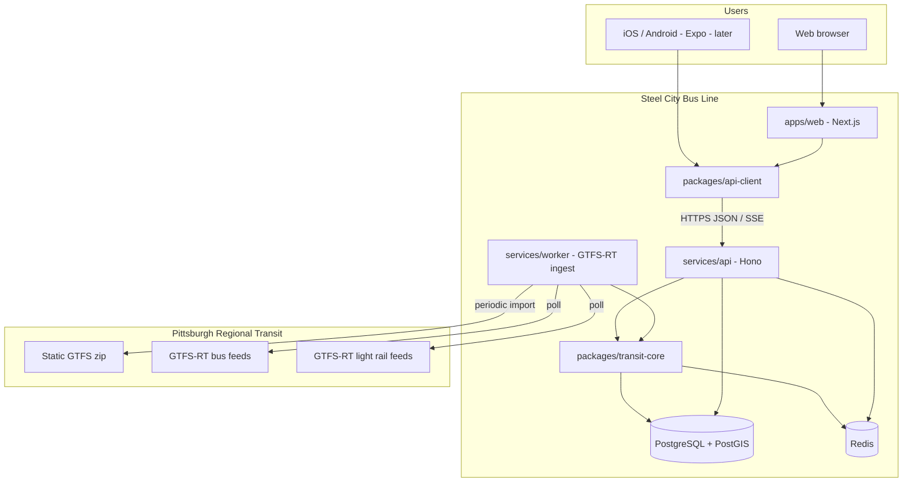
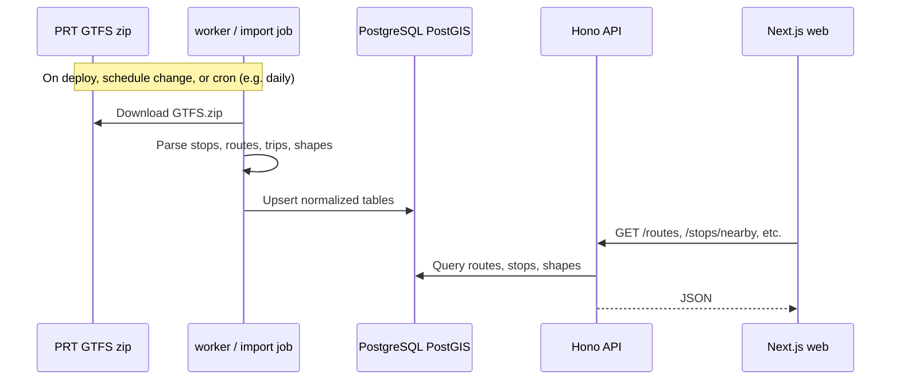
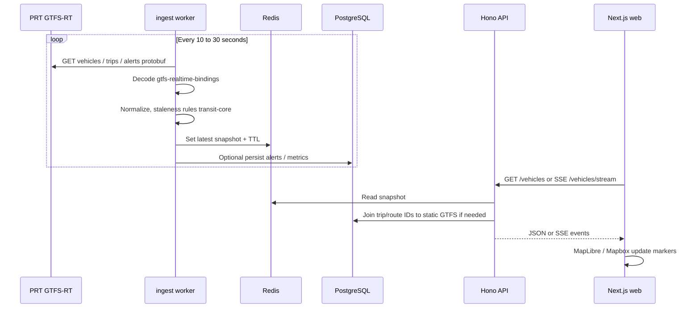
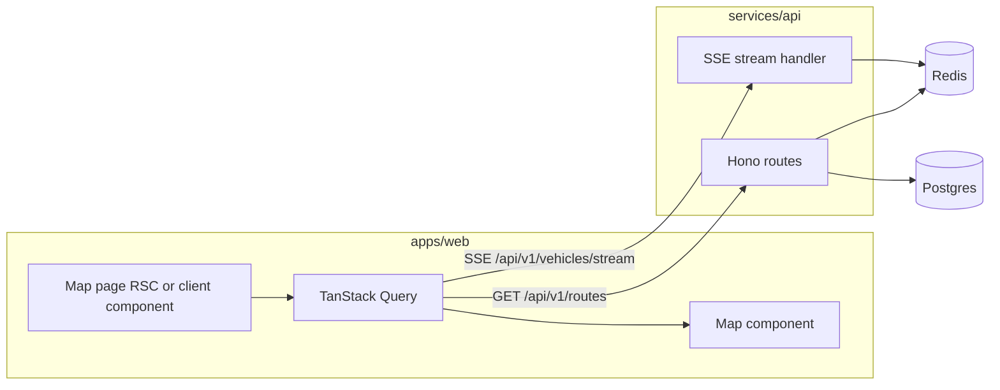
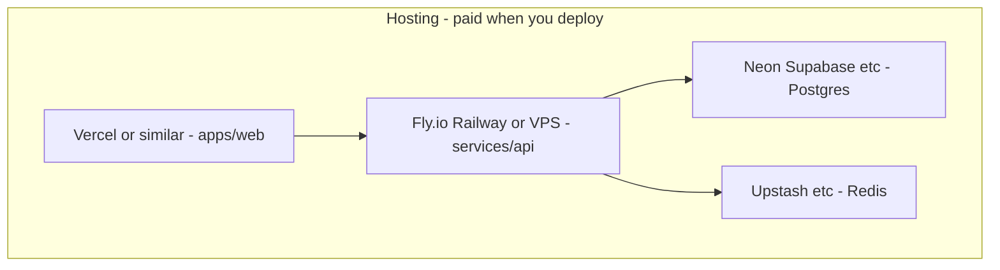
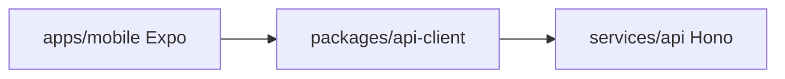

# Steel City Bus Line — Architecture

Pittsburgh metro transit app: accurate routes, live vehicle positions, and better UX than official tools. **Web first** (`apps/web`), **native mobile later** (`apps/mobile` via Expo), backed by a dedicated Node API that ingests PRT data.

This document is the source of truth for **what runs where** and **how data moves**. For implementation status and agent handoff, see [AGENTS.md](./AGENTS.md).

---

## Stack (Option 1)

| Layer | Technology | Notes |
|-------|------------|--------|
| Monorepo | **pnpm** workspaces (+ **Turborepo** when scripts grow) | Single repo, shared packages |
| Language | **TypeScript** | All apps and services |
| Web | **Next.js** (App Router), **React**, **Tailwind CSS** | Ship first |
| Mobile (later) | **Expo** + **Expo Router**, **React Native** | Reuses `packages/api-client` |
| HTTP API | **Hono** on **Node.js 22 LTS** | Long-running; not serverless-only |
| Ingest | **Node worker** (same process as API at v1, split later) | Polls GTFS-RT, writes cache/DB |
| Validation | **Zod** | Shared schemas where possible |
| Database | **PostgreSQL** + **PostGIS** | Static GTFS, geospatial queries |
| Cache | **Redis** | Vehicle snapshots, hot reads |
| DB access | **Drizzle** + migrations | Or Kysely if preferred later |
| GTFS-RT | **`gtfs-realtime-bindings`** | PRT protobuf feeds |
| Web maps | **MapLibre GL JS** or **Mapbox GL JS** | TBD at implementation |
| Client data fetching | **TanStack Query** | Web (+ mobile when added) |
| Live to clients | **SSE** first; WebSocket optional | `/vehicles/stream` |

---

## System context



---

## Data flow (PRT → users)

### 1. Static schedule and map geometry (slow-changing)



### 2. Realtime vehicles and arrivals (fast-changing)



### 3. Why clients never hit PRT directly

| Reason | Detail |
|--------|--------|
| CORS | Browsers cannot call PRT feeds from the client |
| Protobuf | GTFS-RT is not JSON; decoding belongs on the server |
| Product logic | Stale GPS filtering, detour messaging, route labeling fixes live in `transit-core` |
| Rate and stability | One poller; many users read from Redis |

---

## Request flow (live map page)



---

## Monorepo layout (target)

```
Steel-City-Bus-Line/
├── apps/
│   ├── web/                 # Next.js — primary UI (v1)
│   └── mobile/              # Expo — add when starting mobile (stub OK until then)
├── services/
│   ├── api/                 # Hono HTTP + SSE
│   └── worker/              # GTFS-RT poll + GTFS import (optional split from api)
├── packages/
│   ├── transit-core/        # Domain: GTFS, merge static+RT, business rules
│   ├── api-client/          # Typed fetch + SSE for web and mobile
│   └── shared/              # Zod schemas, types, constants
├── ARCHITECTURE.md          # This file
├── AGENTS.md                # Status, conventions, phone/agent handoff
└── README.md
```

---

## API surface (v1 target)

Base path: `/api/v1` (exact prefix TBD at scaffold).

| Method | Path | Purpose |
|--------|------|---------|
| GET | `/routes` | List routes |
| GET | `/routes/:id` | Route detail + stops |
| GET | `/stops/nearby` | `lat`, `lon`, `radius` |
| GET | `/stops/:id/arrivals` | Predictions merged static + RT |
| GET | `/vehicles` | Current snapshot |
| GET | `/vehicles/stream` | SSE live updates |
| GET | `/alerts` | Service alerts |

OpenAPI/Zod documentation can be added on Hono when routes are implemented.

---

## External data sources (PRT)

| Resource | URL / location | Format |
|----------|----------------|--------|
| Static GTFS | [PRT Developer Resources](https://beta.rideprt.org/business-resources/web-developer-resources/) | GTFS zip |
| Bus GTFS-RT | `https://truetime.rideprt.org/gtfsrt-bus/` (vehicles, trips, alerts) | Protobuf |
| Light rail GTFS-RT | PRT train GTFS-RT endpoints (see developer page) | Protobuf |
| TrueTime API | Account-gated; optional later | REST |

Respect PRT developer license terms when downloading and redistributing derived data.

---

## Deployment topology (target)



- **Web**: Static/SSR on Vercel, Cloudflare, or co-located with API.
- **API + worker**: Must run as a **long-lived** Node process (not serverless-only).
- **Secrets**: Environment variables only; never committed (see `.env.example` when added).

---

## Mobile path (Expo, later)



Native maps (`@rnmapbox/maps` or `react-native-maps`) live only in `apps/mobile`. Map logic (layers, markers) is app-specific; route/stop/vehicle **models** come from shared packages.

---

## Security and privacy (baseline)

- Read-only public transit data for v1; no PII required for core features.
- Rate-limit public API endpoints at the edge or in Hono.
- CORS: allow only `apps/web` (and mobile deep links / app origins when configured).

---

## Related documents

| Document | Purpose |
|----------|---------|
| [AGENTS.md](./AGENTS.md) | Current phase, task checklist, phone workflow, session handoff |
| [README.md](./README.md) | Quick start (when scaffold exists) |

When architecture changes, update this file and note the change in **AGENTS.md** → **Changelog**.
